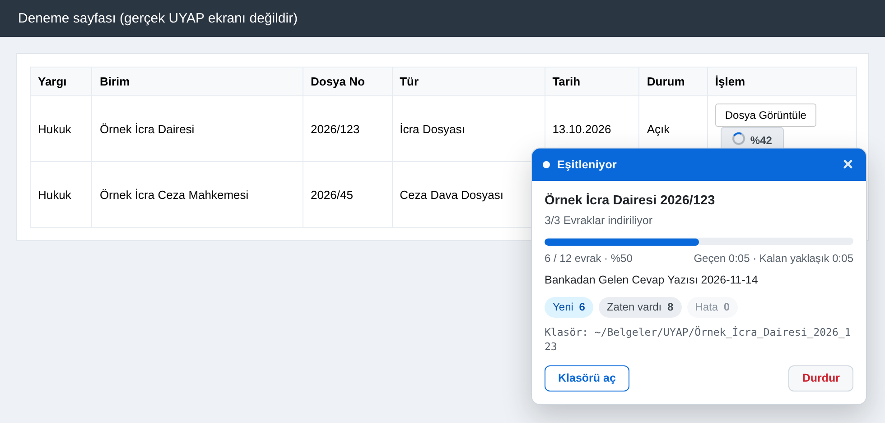
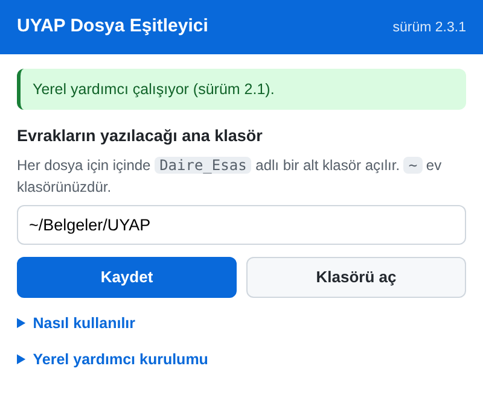

# UYAP Dosya Eşitleyici

UYAP Vatandaş Portal'daki bir dosyanın bütün evraklarını tek tıkla bilgisayarınızdaki bir klasöre indiren tarayıcı eklentisi. Klasörde zaten olan evrakları atlar, yalnızca yenileri yazar.

> Resmî bir uygulama değildir. Adalet Bakanlığı ya da UYAP ile hiçbir bağlantısı yoktur. Kullanım sorumluluğu kullanıcıya aittir.

*Görüntü deneme sayfasından alınmıştır, gerçek UYAP ekranı değildir.*

## Neden

UYAP'ta bir dosyanın evraklarını saklamak için her evrakı tek tek açıp kaydetmek gerekiyor. Dosyaya yeni evrak geldiğinde hangisini indirdiğinizi hatırlamak da ayrı bir iş. Bu eklenti o işi tek düğmeye indirir: Eşitle'ye basarsınız, klasörünüz dosyayla aynı hale gelir.

## Ne yapar

- Dosya Sorgulama ekranındaki her dosya satırına bir **Eşitle** düğmesi ekler.
- Düğmeye basınca dosyanın evrak listesini okur, klasörde olmayan evrakları indirir.
- Her dosya için ayrı bir alt klasör açar: `AnaKlasör/Daire_Yıl_No/`
- Evrakları tarihle adlandırır: `YYYY-AA-GG_Evrak_Türü_BirimEvrakNo.pdf`
- Tarayıcının "nereye kaydedilsin" penceresi açılmaz.
- Sağ altta ilerleme paneli gösterir: kaç evrak yazıldı, kaçı zaten vardı, kalan süre.
- Yarıda kalırsa yeniden basınca kaldığı yerden devam eder.
- İndirilemeyen evrak olursa klasöre `_hatalar.txt` yazar.

## Gizlilik

- Yalnızca sizin açtığınız oturumda, sizin görebildiğiniz dosyalarda çalışır.
- Şifre, çerez ya da oturum bilgisi okumaz ve saklamaz.
- UYAP dışında hiçbir sunucuya veri göndermez. Evraklar yalnızca sizin bilgisayarınıza yazılır.
- İstediği izinler: `vatandas.uyap.gov.tr` sayfasında çalışma, ayar saklama, yerel yardımcıyla konuşma.

## Gerekenler

- Chromium tabanlı bir tarayıcı: Brave, Chrome, Chromium ya da Edge
- Python 3

## Kurulum

Bir kez yapılır.

1. Bu depoyu indirin ve bir klasöre açın: [ZIP olarak indir](https://github.com/yildsamteknoloji/uyap_dosya_esitleme/archive/refs/heads/main.zip) ya da
   `git clone https://github.com/yildsamteknoloji/uyap_dosya_esitleme.git`
2. Yerel yardımcıyı tanıtın. Depodaki `native` klasöründe:
   - Linux ve macOS: `bash install.sh`
   - Windows: `install_windows.bat` dosyasına çift tıklayın

   "Kendi kendine test: BAŞARILI" yazmalı.
3. Tarayıcıyı tamamen kapatıp yeniden açın.
4. Uzantılar sayfasını açın (`chrome://extensions` ya da `brave://extensions`), **Geliştirici modu**nu açın, **Paketlenmemiş öğe yükle** ile depo klasörünü seçin.
5. Eklentinin simgesine tıklayın. Açılan pencerede evrakların yazılacağı ana klasörü girip **Kaydet**'e basın.

Ayrıntı ve sorun giderme için: [KURULUM.txt](KURULUM.txt)

### Yerel yardımcı neden gerekli

Tarayıcı eklentileri güvenlik gereği diskte istedikleri klasöre dosya yazamaz ve klasörde ne olduğunu göremez. `native/uyap_esitle_host.py` bu işi yapan küçük bir Python betiğidir: klasörü listeler, dosyayı yazar, klasörü açar. İnternete bağlanmaz. Kurulum betiği yalnızca tarayıcıya "bu eklenti şu betikle konuşabilir" diyen bir kayıt dosyası ekler.

## Kullanım

1. UYAP Vatandaş Portal'a girin ve Dosya Sorgulama ekranında dosyalarınızı sorgulayın.
2. İstediğiniz satırda **Eşitle**'ye basın.
3. Bitince paneldeki **Klasörü aç** ile evraklara gidin.

Eklentiyi güncelledikten sonra uzantılar sayfasında eklentiyi yenileyin, ardından UYAP sekmesini de yenileyin (F5).

## Durum ve sınırlar

- Linux üzerinde Brave ile gerçek kullanımda denendi.
- Windows ve macOS kurulum betikleri yazıldı ama gerçek makinede henüz denenmedi. Deneyip sonucu bildirirseniz sevinirim.
- Yalnızca Vatandaş Portal'da çalışır. Avukat Portal desteklenmez.
- UYAP sayfa yapısını değiştirirse eklenti bozulabilir. Böyle bir durumda [Issue açın](https://github.com/yildsamteknoloji/uyap_dosya_esitleme/issues).
- Firefox desteklenmez.

## Nasıl çalışır

| Dosya | Görevi |
|---|---|
| `page.js` | UYAP sayfasının içinde çalışır: düğmeleri ekler, evrak listesini okur, evrakları indirir, paneli çizer |
| `content.js` | Sayfa ile eklenti arasında mesaj taşır |
| `background.js` | Yerel yardımcıyla konuşur |
| `options.html`, `options.js` | Simgeye basınca açılan ayar penceresi |
| `native/uyap_esitle_host.py` | Yerel yardımcı: klasörü listeler, dosyayı yazar |
| `native/install.py` | Yardımcıyı tarayıcıya tanıtır ya da kaldırır |

## Kaldırma

- Linux ve macOS: `bash install.sh --kaldir`
- Windows: `install_windows.bat --kaldir`
- Sonra eklentiyi uzantılar sayfasından kaldırın.

## Lisans

[PolyForm Noncommercial 1.0.0](LICENSE)

- Kişisel ve ticari olmayan kullanım serbesttir: kendi dosyalarınız için kullanabilir, kodu inceleyebilir, değiştirebilir, ticari olmayan amaçla paylaşabilirsiniz.
- **Ticari kullanım için önceden yazılı izin gerekir.** Ücretli bir hizmetin ya da ürünün parçası yapmak, satmak, müşteri işleri için büro ya da şirket bünyesinde kullanmak buna dahildir.
- İzin için [Issue açın](https://github.com/yildsamteknoloji/uyap_dosya_esitleme/issues).
- Kopyaladığınız ya da dağıttığınız her sürümde lisans metni ve telif satırı korunmalıdır.

Telif hakkı 2026 Yıldsam Teknoloji (Saadettin Yıldırım)
